# Web Route Map

The current application uses `HashRouter`. Phase 5A retains all existing routes
and adds a mobile hamburger/sidebar navigation below 768px. Desktop retains top
navigation and the Settings menu. Mobile navigation includes all primary routes,
Categories, Payees, Settings and About, with native backup/restore/update actions
only where the platform supports them. It closes after selection, on route
changes and when resizing to desktop. There are no persistent bottom tabs.

Phase 5B adds no routes. The transaction form now renders through the shared
`ResponsiveOverlay`: a bottom drawer below 768px and the existing centered
dialog above it. On phones, tapping a transaction opens read-only details in
the same surface; Edit is an explicit second step.

Phase 5C adds no routes. `/` lists accounts as cards. Tapping a card goes to
`/accounts/:id`. Below 1024px that page shows a "Selected account" card whose
**Change account** chooser (a drawer on phones, a popover on tablets) moves
between `/accounts/:id` routes or back to `/`. The accounts sidebar appears
only at 1024px and above.

Phase 5D adds no routes. `/accounts/:id` renders transactions as cards
instead of a table, with a Filter popover and a More-actions menu in the
header. Tapping a card opens the existing read-only details view through
`ResponsiveOverlay` at every width (previously phone-only); the dialog
variant now serves desktop details as well as edit.

```mermaid
flowchart TD
  App --> Router[HashRouter + Layout]
  Router --> Home["/"]
  Router --> Accounts["/accounts/:id"]
  Router --> Categories["/categories"]
  Router --> Payees["/payees"]
  Router --> Scheduled["/scheduled"]
  Router --> Reconcile["/reconcile/:id"]
  Router --> Forecast["/forecast/:id"]
  Router --> Settings["/settings"]
  Router --> Budget["/budget"]
  Router --> Reports["/reports"]

  Home --> AccountForm[Account form dialog]
  Home --> ReconcileDialog[Reconciliation dialog]
  Accounts --> TransactionForm[Transaction details/editor: phone drawer, desktop dialog]
  Accounts --> ImportDialog[Import dialog]
  Accounts --> AccountReconcile[Reconciliation dialog]
  Accounts --> DeleteTransaction[Delete confirmation]
  Categories --> CategoryForm[Category form]
  Categories --> DeleteCategory[Delete confirmation]
  Payees --> PayeeForm[Payee form]
  Payees --> DeletePayee[Delete confirmation]
  Scheduled --> ScheduledForm[Scheduled payment dialog]
  Scheduled --> RecordPayment[Record payment dialog]
  Scheduled --> DeleteScheduled[Delete confirmation]
  Reconcile --> ReconcileTransaction[Transaction editor: phone drawer, desktop dialog]
  Forecast --> ForecastHelp[Forecast help dialog]
  Settings --> About[About dialog]
  Settings --> Backup[Backup dialog]
  Settings --> Restore[Restore dialog]
  Settings --> ImportConfirm[Import confirmation]
  Budget --> EnvelopeForm[Envelope form dialog]
  Budget --> MoveMoney[Move money dialog]
```

The shell also owns navigation, account switching, update actions, and global
menus. Several components use `Sheet` terminology internally, but most current
data-entry workflows render as dialogs. Phone-specific full-height sheets and
focused routes require Phase 5 product approval.
