# Web Route Map

The application uses `HashRouter` (required for `file://` in Electron). Routes
are identical on every platform; only their layout changes by width.

- **Below 768px (phone):** hamburger/sidebar navigation (no persistent bottom
  tabs). The header bar carries the page title, a back arrow on detail routes,
  and the primary action. The menu lists all primary routes, Categories,
  Payees and Settings, with the app version at the bottom; native
  backup/restore/update actions appear only where the platform supports them.
- **768px and up:** top navigation and the Settings menu; About is a dialog.
- **Lists** (accounts, transactions, reconcile, forecast, scheduled,
  categories, payees, budget envelopes) render as cards. Tapping a card opens
  read-only details; edit, record, skip and delete are explicit actions and
  deletes go through `ConfirmDialog`.
- **Forms and details** use `ResponsiveOverlay`: a bottom drawer on phones, a
  centred dialog from 768px. `ConfirmDialog` is the shared destructive confirm.
- **Reports** wraps its controls, and every chart has a text "Show values" list.
- **Web only:** QIF import and backup/restore are hidden (no file-picker
  adapter); portable import/export is available in Settings on every platform.

```mermaid
flowchart TD
  App --> Router[HashRouter + Layout]
  Router --> Home["/"]
  Router --> Accounts["/accounts/:id"]
  Router --> Categories["/categories"]
  Router --> Payees["/payees"]
  Router --> Scheduled["/scheduled"]
  Router --> Reconcile["/reconcile/:id"]
  Router --> Forecast["/forecast/:id"]
  Router --> Settings["/settings"]
  Router --> Budget["/budget"]
  Router --> Reports["/reports"]

  Home --> AccountForm[Account form: phone drawer, desktop dialog]
  Home --> ReconcileDialog[Reconciliation dialog]
  Accounts --> TransactionForm[Transaction details/editor: phone drawer, desktop dialog]
  Accounts --> ImportDialog[QIF review: expanded drawer, Electron only]
  Accounts --> AccountReconcile[Reconciliation dialog]
  Accounts --> DeleteTransaction[Delete confirmation]
  Categories --> CategoryForm[Category details and form overlay]
  Categories --> DeleteCategory[Delete confirmation]
  Payees --> PayeeForm[Payee details and form overlay]
  Payees --> DeletePayee[Delete confirmation]
  Scheduled --> ScheduledForm[Scheduled payment details/editor overlay]
  Scheduled --> RecordPayment[Record payment confirmation/editor overlay]
  Scheduled --> DeleteScheduled[Delete confirmation]
  Reconcile --> ReconcileTransaction[Transaction editor: phone drawer, desktop dialog]
  Forecast --> ForecastDetails[Projected row details overlay]
  Forecast --> ForecastHelp[Forecast help overlay]
  Settings --> About[About overlay: phone drawer, desktop dialog]
  Settings --> Backup[Backup overlay, Electron only]
  Settings --> Restore[Restore overlay, Electron only]
  Settings --> ImportConfirm[Import replacement confirmation]
  Budget --> EnvelopeForm[Envelope editor overlay]
  Budget --> MoveMoney[Move money overlay]
  Budget --> FillConfirm[Fill from last month confirmation]
  Budget --> DeleteEnvelope[Delete confirmation]
```

The shell also owns navigation, account switching, update actions, and global
menus. Data-entry, details, confirmation and information surfaces render through
`ResponsiveOverlay` (drawer below 768px, dialog above) or the shared
`ConfirmDialog`; the navigation `Sheet`, popovers and menus are the intentional
exceptions listed in `docs/PHASE5_UX_PLAN.md`.
