# Web Route Map

The current application uses `HashRouter`. Phase 5A retains all existing routes
and adds a mobile hamburger/sidebar navigation below 768px. Desktop retains top
navigation and the Settings menu. Mobile navigation includes all primary routes,
Categories, Payees, Settings and About, with native backup/restore/update actions
only where the platform supports them. It closes after selection, on route
changes and when resizing to desktop. There are no persistent bottom tabs.

Phase 5B adds no routes. The transaction form now renders through the shared
`ResponsiveOverlay`: a bottom drawer below 768px and the existing centered
dialog above it. On phones, tapping a transaction opens read-only details in
the same surface; Edit is an explicit second step.

Phase 5C adds no routes. `/` lists accounts as cards. Tapping a card goes to
`/accounts/:id`. Below 1024px that page shows a "Selected account" card whose
**Change account** chooser (a drawer on phones, a popover on tablets) moves
between `/accounts/:id` routes or back to `/`. The accounts sidebar appears
only at 1024px and above.

Phase 5D adds no routes. `/accounts/:id` renders transactions as cards
instead of a table, with a Filter popover and a More-actions menu in the
header. Tapping a card opens the existing read-only details view through
`ResponsiveOverlay` at every width (previously phone-only); the dialog
variant now serves desktop details as well as edit.

Phase 5E adds no routes. The QIF import review (`/accounts/:id`) is a
`ResponsiveOverlay` (expanded drawer on phones) and is offered only where the
platform has a file picker (Electron). Native Backup/Restore remain Electron-only
overlays, and portable import replacement uses the shared `ConfirmDialog`.

Phase 5F adds no routes. `/reconcile/:id` lists transactions as selectable cards
with a separate Edit button that opens the transaction editor overlay.
`/categories` and `/payees` are card lists whose details, create and edit forms
are `ResponsiveOverlay`s, with deletes confirmed through `ConfirmDialog`.

Phase 5G adds no routes. `/scheduled` renders subscriptions as cards. Tapping one
opens read-only details in the scheduled payment overlay (edit and record
payment are explicit steps), and delete uses `ConfirmDialog`. One account filter
drives the list, summary and calendar.

Phase 5H adds no routes. `/budget` envelope create/edit and Move money are
controlled `ResponsiveOverlay`s owned by the page; Fill from last month and
envelope deletion use `ConfirmDialog`.

Phase 5I adds no routes. `/forecast/:id` lists projected rows as cards (whole
card toggles inclusion, a separate Details button opens a read-only overlay) and
Help is an information overlay. `/reports` wraps its controls under the heading
and gives each chart a text "Show values" list. About (header and settings) is an
information overlay: a content-sized drawer on phones, a dialog from 768px.

```mermaid
flowchart TD
  App --> Router[HashRouter + Layout]
  Router --> Home["/"]
  Router --> Accounts["/accounts/:id"]
  Router --> Categories["/categories"]
  Router --> Payees["/payees"]
  Router --> Scheduled["/scheduled"]
  Router --> Reconcile["/reconcile/:id"]
  Router --> Forecast["/forecast/:id"]
  Router --> Settings["/settings"]
  Router --> Budget["/budget"]
  Router --> Reports["/reports"]

  Home --> AccountForm[Account form: phone drawer, desktop dialog]
  Home --> ReconcileDialog[Reconciliation dialog]
  Accounts --> TransactionForm[Transaction details/editor: phone drawer, desktop dialog]
  Accounts --> ImportDialog[QIF review: expanded drawer, Electron only]
  Accounts --> AccountReconcile[Reconciliation dialog]
  Accounts --> DeleteTransaction[Delete confirmation]
  Categories --> CategoryForm[Category details and form overlay]
  Categories --> DeleteCategory[Delete confirmation]
  Payees --> PayeeForm[Payee details and form overlay]
  Payees --> DeletePayee[Delete confirmation]
  Scheduled --> ScheduledForm[Scheduled payment details/editor overlay]
  Scheduled --> RecordPayment[Record payment confirmation/editor overlay]
  Scheduled --> DeleteScheduled[Delete confirmation]
  Reconcile --> ReconcileTransaction[Transaction editor: phone drawer, desktop dialog]
  Forecast --> ForecastDetails[Projected row details overlay]
  Forecast --> ForecastHelp[Forecast help overlay]
  Settings --> About[About overlay: phone drawer, desktop dialog]
  Settings --> Backup[Backup overlay, Electron only]
  Settings --> Restore[Restore overlay, Electron only]
  Settings --> ImportConfirm[Import replacement confirmation]
  Budget --> EnvelopeForm[Envelope editor overlay]
  Budget --> MoveMoney[Move money overlay]
  Budget --> FillConfirm[Fill from last month confirmation]
  Budget --> DeleteEnvelope[Delete confirmation]
```

The shell also owns navigation, account switching, update actions, and global
menus. Data-entry, details, confirmation and information surfaces render through
`ResponsiveOverlay` (drawer below 768px, dialog above) or the shared
`ConfirmDialog`; the navigation `Sheet`, popovers and menus are the intentional
exceptions listed in `docs/PHASE5_UX_PLAN.md`.
